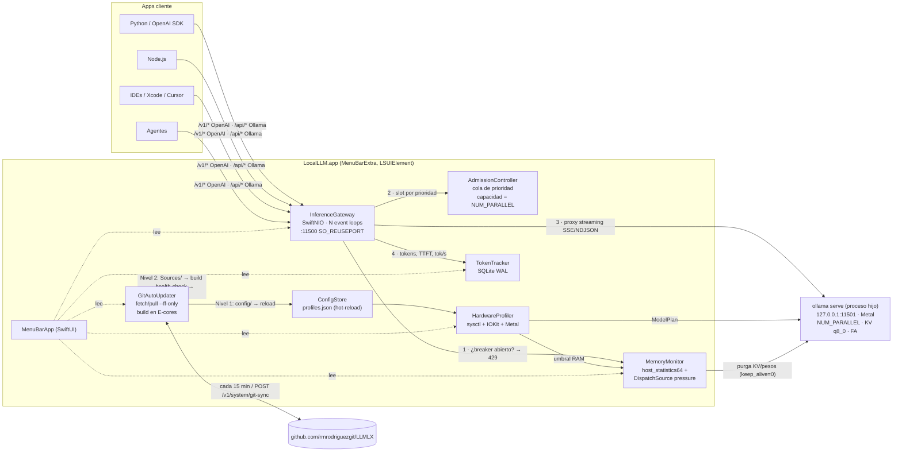

# LLMLX

**LocalLLM**: una app nativa de barra de menú para macOS (Apple Silicon) que hace de gateway de inferencia local sobre Ollama. Perfila el hardware, elige el modelo y los parámetros que caben en tu Mac, protege la RAM frente al swap, registra cada token en SQLite y se actualiza sola desde este repositorio Git.

Está calibrada para un **Apple M3 con 16 GB** de memoria unificada y escala de forma automática a Macs de 8 GB a 192 GB.

---

## 1. Arquitectura



Flujo de una petición de inferencia:

1. **Origin check**: si la petición trae cabecera `Origin` de una web que no está en `allowedOrigins`, se rechaza con 403. Los SDK, curl y los IDE no envían `Origin`.
2. **Memory Guard**: si la RAM disponible está por debajo del umbral del perfil (1.8 GiB en 16 GB), responde `429` con `Retry-After`.
3. **Admisión**: espera un slot libre (capacidad = `OLLAMA_NUM_PARALLEL`). El orden es `X-Priority: high > normal > low` y FIFO dentro de cada clase. Si la cola está llena responde `429`; si se agota el tiempo de espera, `503`.
4. **Enrutado**: `gpt-4o`, `default`, `local`, etc. → modelo auto-seleccionado. Si pides un modelo que ya está instalado, se usa ese.
5. **Proxy**: hace streaming línea a línea hacia el cliente. Si el cliente se desconecta, se cancela la petición a Ollama y el slot queda libre.
6. **Telemetría**: los contadores exactos del motor se guardan en SQLite en un hilo aparte, así que no bloquean la respuesta.

### Actualización automática

```
fetch origin/main ──► ¿cambió? ──no──► fin
        │sí
        ▼
pull --ff-only ──► ¿config/? ──► validar + hot-reload (sin cortar conexiones)
        │              └─ inválido ─► git reset --hard ORIG_HEAD + incidente
        ▼
¿Sources/ o Package.swift?
        ▼
taskpolicy -b swift build -c release -j <E-cores>    (QoS background → núcleos de eficiencia)
        │ falla ─► reset --hard ORIG_HEAD + incidente + commit marcado como malo
        ▼
candidato --health-check en puerto efímero (≤10 s) ── falla ─► rollback
        ▼
symlink bin/current (rename atómico)
        ▼
blue/green: nuevo proceso enlaza :11500 (SO_REUSEPORT) y adopta Ollama (sin recargar el modelo)
        ▼ SIGUSR1 "listo"
el proceso viejo cierra el listener, drena las peticiones en vuelo y sale
```

---

## 2. Árbol del proyecto

```
LLMLX/
├── Package.swift                      # SwiftPM: ejecutable LocalLLM (macOS 13+, swift-nio)
├── build_dmg.sh                       # Release arm64 → .app → embebe Ollama → firma → LocalLLM-M3.dmg
├── config/
│   └── profiles.json                  # Configuración remota (hot-reload vía Git)
├── scripts/
│   └── embed_config.sh                # Regenera EmbeddedConfig.swift desde profiles.json
└── Sources/LocalLLM/
    ├── MenuBarApp.swift               # @main, modos --headless/--health-check, UI SwiftUI
    ├── AppCoordinator.swift           # Ciclo de vida, hot-reload, blue/green, payloads, Launcher
    ├── HardwareProfiler.swift         # sysctlbyname + IOKit (AGXAccelerator) + Metal → ModelPlan
    ├── MemoryMonitor.swift            # host_statistics64 + vm.swapusage + memory pressure → breaker
    ├── AdmissionController.swift      # Cola de prioridad con timeout/cancelación
    ├── InferenceGateway.swift         # Servidor HTTP SwiftNIO, proxy streaming, endpoints sistema
    ├── TokenTracker.swift             # SQLite WAL + extractor de usage (SSE/NDJSON)
    ├── OllamaProcessManager.swift     # Proceso hijo supervisado, env por perfil, pull/warmup/unload
    ├── GitAutoUpdater.swift           # Sync, build en E-cores, health-check, swap atómico, rollback
    ├── ConfigStore.swift              # Esquema + validación + hot-reload de profiles.json
    ├── EmbeddedConfig.swift           # Copia embebida de profiles.json (último recurso)
    └── Support.swift                  # Paths, logging, ProcessRunner, JSON, Locked<T>
```

Archivos en tiempo de ejecución (`~/Library/Application Support/LocalLLM/`):

| Ruta | Contenido |
|---|---|
| `repo/` | Clon local de este repositorio (se siembra desde el `.dmg` y luego sigue a `origin/main`) |
| `telemetry.sqlite` (+`-wal`) | Tabla `requests` (cada petición) e `incidents` (breaker, rollbacks, hand-offs) |
| `bin/LocalLLM-<sha>`, `bin/current` | Binarios auto-compilados y el symlink activo |
| `ollama.pid.json` | PID y hash de configuración del Ollama gestionado (para adoptarlo en el hand-off) |
| `updater-state.json` | Último commit, último resultado y commits marcados como malos |

Logs en `~/Library/Logs/LocalLLM/`: `localllm.log`, `ollama.log` y `auto-update-build.log`.

---

## 3. Matriz de hardware → modelo

| RAM | Perfil | Modelo (Q4_K_M) | num_ctx | NUM_PARALLEL | Presupuesto Metal | Breaker |
|---|---|---|---|---|---|---|
| 8 GB | `apple-8gb` | `qwen3:4b` / `llama3.2:3b` | 4096 | 1 | ~5.3 GiB | < 1.0 GiB |
| **16 GB** | **`apple-16gb`** | **`qwen3:8b` / `qwen2.5:7b`** | **8192** | **2** | **~10.75 GiB** | **< 1.8 GiB** |
| 24–48 GB | `apple-24-48gb` | `qwen2.5-coder:14b` / `qwen3:8b-q8_0` | 16384 | 4 | ~20 GiB | < 3 GiB |
| 64–96 GB | `apple-64-96gb` | `qwen3:32b` | 32768* | 6 | ~46 GiB | < 6 GiB |
| 128 GB+ | `apple-128gb-plus` | `llama3.3:70b` | 32768 | 6 | ~96 GiB | < 10 GiB |

Todos los perfiles usan `OLLAMA_KV_CACHE_TYPE=q8_0`, `OLLAMA_FLASH_ATTENTION=1`, `num_gpu=999` y `OLLAMA_MAX_LOADED_MODELS=1`.

El profiler no aplica la tabla a ciegas. Calcula `pesos + KV(paralelo × ctx × bytes/token) + buffers` y lo compara con `min(presupuesto del perfil, Metal recommendedMaxWorkingSetSize, RAM − 4 GiB)`. Si el plan no cabe, reduce `num_ctx`, después el paralelismo y, como último paso, baja de perfil. (*) Por ejemplo, el perfil de 64 GB baja a 16k de contexto para caber. Cada decisión queda explicada en `GET /v1/hardware-profile`.

Puedes forzar un perfil o un modelo con `LOCALLLM_FORCE_PROFILE` y `LOCALLLM_FORCE_MODEL`.

---

## 4. API

Base URL: `http://127.0.0.1:11500`

| Método | Ruta | Descripción |
|---|---|---|
| POST | `/v1/chat/completions`, `/v1/completions` | OpenAI compatible (stream o no); con conteo de tokens |
| POST | `/api/chat`, `/api/generate` | Ollama nativo; con conteo de tokens y tiempos del motor |
| * | `/api/*`, `/v1/models`, `/v1/embeddings`… | Proxy transparente a Ollama |
| GET | `/v1/hardware-profile` | Hardware detectado, plan elegido, razones, env de Ollama, RAM actual |
| GET | `/v1/metrics?window=1h\|24h\|7d\|session\|all` | Totales, por cliente/modelo/endpoint, p50/p95 TTFT y tok/s, últimas peticiones, incidentes |
| POST | `/v1/system/git-sync` | Sincroniza ya (`200` si terminó; `202` si quedó compilando) |
| GET | `/v1/system/git-status` | Estado del actualizador |
| POST | `/v1/system/reload-config` | Recarga `profiles.json` en caliente |
| GET | `/health` | Health-check |

Cabeceras opcionales:
- `X-Client-App: mi-agente` identifica al cliente en las métricas. Sin ella se usa el producto del `User-Agent`.
- `X-Priority: high|normal|low` fija la prioridad en la cola. También se puede definir por app en `routing.clientPriorities`.

```python
from openai import OpenAI
client = OpenAI(base_url="http://127.0.0.1:11500/v1", api_key="local",
                default_headers={"X-Client-App": "mi-script", "X-Priority": "high"})
for chunk in client.chat.completions.create(model="default", stream=True,
        messages=[{"role": "user", "content": "Hola"}]):
    print(chunk.choices[0].delta.content or "", end="")
```

```bash
curl http://127.0.0.1:11500/v1/metrics?window=24h
curl http://127.0.0.1:11500/v1/hardware-profile
curl -X POST http://127.0.0.1:11500/v1/system/git-sync
```

### Precisión de la telemetría
- **`/api/chat`, `/api/generate`**: `prompt_eval_count`, `eval_count`, `prompt_eval_duration`, `eval_duration` y `load_duration` vienen del motor, también en el chunk final `done:true` del stream. `tok/s = eval_count / eval_duration`.
- **`/v1/*`**: en modo stream, el gateway inyecta `stream_options.include_usage=true` para recibir los conteos exactos del motor. Si el cliente no lo había pedido, ese chunk se le oculta. La API OpenAI de Ollama no expone duraciones, así que TTFT y tok/s se miden en el gateway con reloj monotónico (`timing_source = gateway`). En modo no-stream se guardan los tokens, pero no TTFT ni tok/s.

---

## 5. Compilar y empaquetar

Requisitos: macOS 13 o superior en Apple Silicon y Xcode Command Line Tools (`xcode-select --install`).

```bash
swift build -c release            # compilar
.build/release/LocalLLM --headless   # ejecutar sin UI (servidor)
./build_dmg.sh                    # genera dist/LocalLLM-M3.dmg (descarga Ollama)
```

```bash
OLLAMA_BIN=/opt/homebrew/bin/ollama ./build_dmg.sh   # usar un Ollama local en vez de descargarlo
```

```bash
SIGN_IDENTITY="Developer ID Application: Tu Nombre (TEAMID)" NOTARY_PROFILE=perfil ./build_dmg.sh
```

El DMG firmado ad-hoc (por defecto) sirve para tus propios Macs. Para distribuirlo a otros sin el aviso de Gatekeeper hace falta firmar con Developer ID y notarizar (tercera variante).

---

## 6. Notas y límites conocidos

- **Purga de KV-cache**: Ollama no tiene API para vaciar solo el KV-cache. Cuando salta el breaker y no hay generaciones en curso, el gateway descarga el modelo (`keep_alive: 0`), lo que libera pesos y KV. Si hay generaciones activas, la purga espera a que terminen. La siguiente petición vuelve a cargar el modelo (~1–3 s).
- **RAM disponible** = libre + especulativa + purgable + caché de archivos. Es una medida conservadora: no cuenta las páginas anónimas inactivas, que solo se recuperan comprimiendo o paginando a swap.
- **`num_ctx` y `num_gpu`** se inyectan en las rutas nativas. En las rutas `/v1/*` se aplican vía `OLLAMA_CONTEXT_LENGTH` (Ollama ya descarga todas las capas a Metal en Apple Silicon).
- **Nivel 2 (recompilación)** necesita Command Line Tools en el Mac destino. Sin ellas, la configuración se sigue recargando en caliente y el código queda marcado como "pendiente".
- **Puerto**: el gateway usa `11500` y Ollama `11501` para convivir con una instalación de Ollama que ya esté en `11434`. Los modelos se comparten en `~/.ollama/models`.
