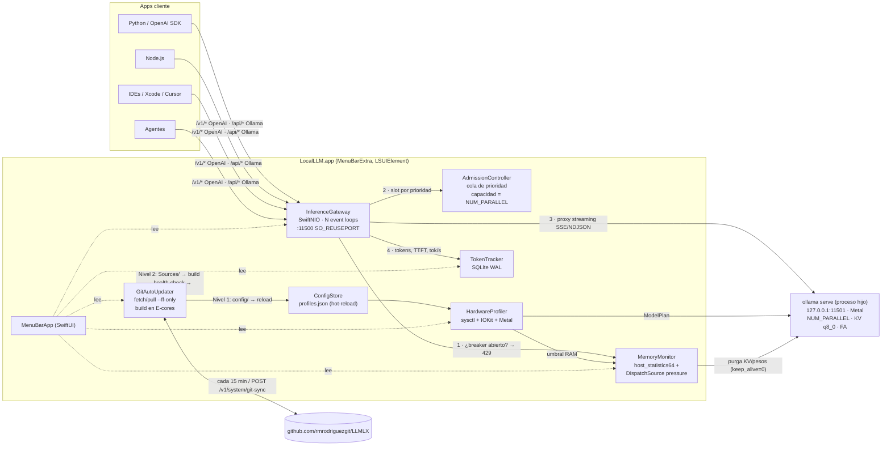

# LLMLX

**LocalLLM**: una app nativa de barra de menú para macOS (Apple Silicon) que hace de gateway de inferencia local sobre Ollama. Perfila el hardware, elige el modelo y los parámetros que caben en tu Mac, protege la RAM frente al swap, registra cada token en SQLite y se actualiza sola desde este repositorio Git.

Está calibrada para un **Apple M3 con 16 GB** de memoria unificada y escala de forma automática a Macs de 8 GB a 192 GB.

---

## 1. Arquitectura



Flujo de una petición de inferencia:

1. **Origin check**: si la petición trae cabecera `Origin` de una web que no está en `allowedOrigins`, se rechaza con 403. Los SDK, curl y los IDE no envían `Origin`.
2. **Memory Guard**: si la RAM disponible está por debajo del umbral del perfil (1.8 GiB en 16 GB), responde `429` con `Retry-After`.
3. **Admisión**: espera un slot libre (capacidad = `OLLAMA_NUM_PARALLEL`). El orden es `X-Priority: high > normal > low` y FIFO dentro de cada clase. Si la cola está llena responde `429`; si se agota el tiempo de espera, `503`.
4. **Enrutado**: `gpt-4o`, `default`, `local`, etc. → modelo auto-seleccionado. Si pides un modelo que ya está instalado, se usa ese.
5. **Proxy**: hace streaming línea a línea hacia el cliente. Si el cliente se desconecta, se cancela la petición a Ollama y el slot queda libre.
6. **Telemetría**: los contadores exactos del motor se guardan en SQLite en un hilo aparte, así que no bloquean la respuesta.

### Actualización automática

```
fetch origin/main ──► ¿cambió? ──no──► fin
        │sí
        ▼
pull --ff-only ──► ¿config/? ──► validar + hot-reload (sin cortar conexiones)
        │              └─ inválido ─► git reset --hard ORIG_HEAD + incidente
        ▼
¿Sources/ o Package.swift?
        ▼
taskpolicy -b swift build -c release -j <E-cores>    (QoS background → núcleos de eficiencia)
        │ falla ─► reset --hard ORIG_HEAD + incidente + commit marcado como malo
        ▼
candidato --health-check en puerto efímero (≤10 s) ── falla ─► rollback
        ▼
symlink bin/current (rename atómico)
        ▼
blue/green: nuevo proceso enlaza :11500 (SO_REUSEPORT) y adopta Ollama (sin recargar el modelo)
        ▼ SIGUSR1 "listo"
el proceso viejo cierra el listener, drena las peticiones en vuelo y sale
```

---

## 2. Árbol del proyecto

```
LLMLX/
├── Package.swift                      # SwiftPM: ejecutable LocalLLM (macOS 13+, swift-nio)
├── build_dmg.sh                       # Release arm64 → .app → embebe Ollama → firma → LocalLLM-M3.dmg
├── config/
│   └── profiles.json                  # Configuración remota (hot-reload vía Git)
├── scripts/
│   └── embed_config.sh                # Regenera EmbeddedConfig.swift desde profiles.json
└── Sources/LocalLLM/
    ├── MenuBarApp.swift               # @main, modos --headless/--health-check, UI SwiftUI
    ├── AppCoordinator.swift           # Ciclo de vida, hot-reload, blue/green, payloads, Launcher
    ├── HardwareProfiler.swift         # sysctlbyname + IOKit (AGXAccelerator) + Metal → ModelPlan
    ├── MemoryMonitor.swift            # host_statistics64 + vm.swapusage + memory pressure → breaker
    ├── AdmissionController.swift      # Cola de prioridad con timeout/cancelación
    ├── InferenceGateway.swift         # Servidor HTTP SwiftNIO, proxy streaming, endpoints sistema
    ├── TokenTracker.swift             # SQLite WAL + extractor de usage (SSE/NDJSON)
    ├── OllamaProcessManager.swift     # Proceso hijo supervisado, env por perfil, pull/warmup/unload
    ├── GitAutoUpdater.swift           # Sync, build en E-cores, health-check, swap atómico, rollback
    ├── ConfigStore.swift              # Esquema + validación + hot-reload de profiles.json
    ├── EmbeddedConfig.swift           # Copia embebida de profiles.json (último recurso)
    └── Support.swift                  # Paths, logging, ProcessRunner, JSON, Locked<T>
```

Archivos en tiempo de ejecución (`~/Library/Application Support/LocalLLM/`):

| Ruta | Contenido |
|---|---|
| `repo/` | Clon local de este repositorio (se siembra desde el `.dmg` y luego sigue a `origin/main`) |
| `telemetry.sqlite` (+`-wal`) | Tabla `requests` (cada petición) e `incidents` (breaker, rollbacks, hand-offs) |
| `bin/LocalLLM-<sha>`, `bin/current` | Binarios auto-compilados y el symlink activo |
| `ollama.pid.json` | PID y hash de configuración del Ollama gestionado (para adoptarlo en el hand-off) |
| `updater-state.json` | Último commit, último resultado y commits marcados como malos |

Logs en `~/Library/Logs/LocalLLM/`: `localllm.log`, `ollama.log` y `auto-update-build.log`.

---

## 3. Matriz de hardware → modelo

| RAM | Perfil | Modelo (Q4_K_M) | num_ctx | NUM_PARALLEL | Presupuesto Metal | Breaker |
|---|---|---|---|---|---|---|
| 8 GB | `apple-8gb` | `qwen3:4b` / `llama3.2:3b` | 4096 | 1 | ~5.3 GiB | < 1.0 GiB |
| **16 GB** | **`apple-16gb`** | **`qwen3:8b` / `qwen2.5:7b`** | **8192** | **2** | **~10.75 GiB** | **< 1.8 GiB** |
| 24–48 GB | `apple-24-48gb` | `qwen2.5-coder:14b` / `qwen3:8b-q8_0` | 16384 | 4 | ~20 GiB | < 3 GiB |
| 64–96 GB | `apple-64-96gb` | `qwen3:32b` | 32768* | 6 | ~46 GiB | < 6 GiB |
| 128 GB+ | `apple-128gb-plus` | `llama3.3:70b` | 32768 | 6 | ~96 GiB | < 10 GiB |

Todos los perfiles usan `OLLAMA_KV_CACHE_TYPE=q8_0`, `OLLAMA_FLASH_ATTENTION=1`, `num_gpu=999` y `OLLAMA_MAX_LOADED_MODELS=1`.

El profiler no aplica la tabla a ciegas. Calcula `pesos + KV(paralelo × ctx × bytes/token) + buffers` y lo compara con `min(presupuesto del perfil, Metal recommendedMaxWorkingSetSize, RAM − 4 GiB)`. Si el plan no cabe, reduce `num_ctx`, después el paralelismo y, como último paso, baja de perfil. (*) Por ejemplo, el perfil de 64 GB baja a 16k de contexto para caber. Cada decisión queda explicada en `GET /v1/hardware-profile`.

Puedes forzar un perfil o un modelo con `LOCALLLM_FORCE_PROFILE` y `LOCALLLM_FORCE_MODEL`.

---

## 4. API

Base URL: `http://127.0.0.1:11500`

| Método | Ruta | Descripción |
|---|---|---|
| POST | `/v1/chat/completions`, `/v1/completions` | OpenAI compatible (stream o no); con conteo de tokens |
| POST | `/api/chat`, `/api/generate` | Ollama nativo; con conteo de tokens y tiempos del motor |
| * | `/api/*`, `/v1/models`, `/v1/embeddings`… | Proxy transparente a Ollama |
| GET | `/v1/hardware-profile` | Hardware detectado, plan elegido, razones, env de Ollama, RAM actual |
| GET | `/v1/metrics?window=1h\|24h\|7d\|session\|all` | Totales, por cliente/modelo/endpoint, p50/p95 TTFT y tok/s, últimas peticiones, incidentes |
| POST | `/v1/system/git-sync` | Sincroniza ya (`200` si terminó; `202` si quedó compilando) |
| GET | `/v1/system/git-status` | Estado del actualizador |
| POST | `/v1/system/reload-config` | Recarga `profiles.json` en caliente |
| GET | `/health` | Health-check |

Cabeceras opcionales:
- `X-Client-App: mi-agente` identifica al cliente en las métricas. Sin ella se usa el producto del `User-Agent`.
- `X-Priority: high|normal|low` fija la prioridad en la cola. También se puede definir por app en `routing.clientPriorities`.

```python
from openai import OpenAI
client = OpenAI(base_url="http://127.0.0.1:11500/v1", api_key="local",
                default_headers={"X-Client-App": "mi-script", "X-Priority": "high"})
for chunk in client.chat.completions.create(model="default", stream=True,
        messages=[{"role": "user", "content": "Hola"}]):
    print(chunk.choices[0].delta.content or "", end="")
```

```bash
curl http://127.0.0.1:11500/v1/metrics?window=24h
curl http://127.0.0.1:11500/v1/hardware-profile
curl -X POST http://127.0.0.1:11500/v1/system/git-sync
```

### Precisión de la telemetría
- **`/api/chat`, `/api/generate`**: `prompt_eval_count`, `eval_count`, `prompt_eval_duration`, `eval_duration` y `load_duration` vienen del motor, también en el chunk final `done:true` del stream. `tok/s = eval_count / eval_duration`.
- **`/v1/*`**: en modo stream, el gateway inyecta `stream_options.include_usage=true` para recibir los conteos exactos del motor. Si el cliente no lo había pedido, ese chunk se le oculta. La API OpenAI de Ollama no expone duraciones, así que TTFT y tok/s se miden en el gateway con reloj monotónico (`timing_source = gateway`). En modo no-stream se guardan los tokens, pero no TTFT ni tok/s.

---

## 5. Cómo usarlo desde otras apps

LocalLLM expone dos APIs en `http://127.0.0.1:11500`:

| API | Base URL | Úsala con |
|---|---|---|
| OpenAI compatible | `http://127.0.0.1:11500/v1` | SDK `openai` (Python/JS), LangChain, Vercel AI SDK, IDEs, cualquier cliente "OpenAI-compatible" |
| Ollama nativa | `http://127.0.0.1:11500` | librerías `ollama` (Python/JS), apps que ya hablan con Ollama |

Reglas comunes a todos los lenguajes:

- **API key**: no hace falta. Los SDK exigen que haya una, así que pon cualquier valor, por ejemplo `"local"`.
- **Modelo**: usa `"default"`, `"local"` o cualquier alias de `routing.aliases`, como `gpt-4o`. Todos van al modelo que la app eligió para tu Mac (`qwen3:8b` en un M3 de 16 GB). Si pides el nombre exacto de un modelo instalado (`qwen2.5:7b`), se usa ese.
- **`X-Client-App: nombre-de-tu-app`**: la recomiendo. Así tus peticiones aparecen separadas en `GET /v1/metrics`.
- **`X-Priority: high | normal | low`**: es opcional. Usa `high` en la UI interactiva y `low` en los trabajos batch.
- **Errores a manejar**:

  | Código | Cuándo pasa | Qué hacer |
  |---|---|---|
  | `429` + `Retry-After` | Poca RAM (circuit breaker) o cola llena | Reintentar tras esos segundos |
  | `503` | Ningún slot quedó libre a tiempo | Reintentar |
  | `403` | Petición web desde un `Origin` no permitido | Ver [Apps web](#react--vue--apps-web-en-el-navegador) |

- **Variables de entorno**: los SDK oficiales de OpenAI leen estas dos. Con ellas muchas herramientas funcionan sin tocar código:

  ```bash
  export OPENAI_BASE_URL=http://127.0.0.1:11500/v1
  export OPENAI_API_KEY=local
  ```

- **Comprobar que está corriendo**: `GET /health` devuelve `{"status":"ok", "model": ..., "engine": ...}`.

### Python

```bash
pip install openai        # o: pip install ollama / langchain-openai / httpx
```

**SDK de OpenAI (streaming):**

```python
from openai import OpenAI

client = OpenAI(
    base_url="http://127.0.0.1:11500/v1",
    api_key="local",
    default_headers={"X-Client-App": "mi-script-python", "X-Priority": "high"},
    max_retries=3,            # el SDK ya reintenta 429/503 respetando Retry-After
)

stream = client.chat.completions.create(
    model="default",
    messages=[{"role": "user", "content": "Explícame qué es la memoria unificada"}],
    stream=True,
)
for chunk in stream:
    if chunk.choices and chunk.choices[0].delta.content:
        print(chunk.choices[0].delta.content, end="", flush=True)
```

**Async + concurrencia** (el gateway encola y prioriza; no hace falta limitar en el cliente):

```python
import asyncio
from openai import AsyncOpenAI

client = AsyncOpenAI(base_url="http://127.0.0.1:11500/v1", api_key="local",
                     default_headers={"X-Client-App": "batch-worker", "X-Priority": "low"})

async def ask(q: str) -> str:
    r = await client.chat.completions.create(model="default", messages=[{"role": "user", "content": q}])
    return r.choices[0].message.content

async def main():
    answers = await asyncio.gather(*(ask(f"Resume el tema {i}") for i in range(10)))
    print(answers)

asyncio.run(main())
```

**Librería `ollama` (API nativa, con tiempos exactos del motor):**

```python
from ollama import Client

client = Client(host="http://127.0.0.1:11500", headers={"X-Client-App": "mi-script-ollama"})
for part in client.chat(model="default", messages=[{"role": "user", "content": "Hola"}], stream=True):
    print(part["message"]["content"], end="", flush=True)
```

**LangChain:**

```python
from langchain_openai import ChatOpenAI

llm = ChatOpenAI(base_url="http://127.0.0.1:11500/v1", api_key="local", model="default",
                 default_headers={"X-Client-App": "langchain-agent"})
print(llm.invoke("¿Qué es RAG?").content)
```

**Embeddings** (necesitas un modelo de embeddings instalado, por ejemplo `ollama pull nomic-embed-text`):

```python
emb = client.embeddings.create(model="nomic-embed-text", input=["hola mundo"])  # cliente OpenAI de arriba
```

### Node.js (y Bun / Deno)

```bash
npm install openai        # o: npm install ollama / ai @ai-sdk/openai-compatible
```

**SDK de OpenAI:**

```js
import OpenAI from "openai";

const client = new OpenAI({
  baseURL: "http://127.0.0.1:11500/v1",
  apiKey: "local",
  defaultHeaders: { "X-Client-App": "mi-api-node" },
  maxRetries: 3,
});

const stream = await client.chat.completions.create({
  model: "default",
  messages: [{ role: "user", content: "Escribe un haiku sobre Apple Silicon" }],
  stream: true,
});
for await (const chunk of stream) {
  process.stdout.write(chunk.choices[0]?.delta?.content ?? "");
}
```

**Librería `ollama`:**

```js
import { Ollama } from "ollama";

const ollama = new Ollama({ host: "http://127.0.0.1:11500", headers: { "X-Client-App": "mi-api-node" } });
const res = await ollama.chat({ model: "default", messages: [{ role: "user", content: "Hola" }] });
console.log(res.message.content, `${res.eval_count} tokens`);
```

**Vercel AI SDK** (Next.js, Express, etc.):

```js
import { createOpenAICompatible } from "@ai-sdk/openai-compatible";
import { streamText } from "ai";

const localllm = createOpenAICompatible({
  name: "localllm",
  baseURL: "http://127.0.0.1:11500/v1",
  headers: { "X-Client-App": "next-app" },
});

const result = streamText({ model: localllm("default"), prompt: "Dame 3 ideas de nombres" });
for await (const text of result.textStream) process.stdout.write(text);
```

**Sin dependencias (`fetch` + SSE)**: sirve también para Node 18+, Deno, Bun, Cloudflare Workers locales, etc.

```js
export async function* chatStream(messages, { model = "default", signal, app = "fetch-client" } = {}) {
  const res = await fetch("http://127.0.0.1:11500/v1/chat/completions", {
    method: "POST",
    headers: { "Content-Type": "application/json", "X-Client-App": app },
    body: JSON.stringify({ model, messages, stream: true }),
    signal,
  });
  if (res.status === 429 || res.status === 503) {
    const wait = Number(res.headers.get("Retry-After") ?? 2);
    throw Object.assign(new Error(`LocalLLM ocupado, reintenta en ${wait}s`), { retryAfter: wait });
  }
  if (!res.ok) throw new Error(`LocalLLM ${res.status}: ${await res.text()}`);

  const reader = res.body.getReader();
  const decoder = new TextDecoder();
  let buffer = "";
  while (true) {
    const { value, done } = await reader.read();
    if (done) break;
    buffer += decoder.decode(value, { stream: true });
    const lines = buffer.split("\n");
    buffer = lines.pop();                       // línea incompleta para la próxima vuelta
    for (const line of lines) {
      if (!line.startsWith("data: ")) continue;
      const data = line.slice(6).trim();
      if (data === "[DONE]") return;
      const delta = JSON.parse(data).choices?.[0]?.delta?.content;
      if (delta) yield delta;
    }
  }
}

// uso
for await (const t of chatStream([{ role: "user", content: "Hola" }])) process.stdout.write(t);
```

### Electron

Haz las llamadas desde el **proceso main**, porque ahí no aplica CORS. Al renderer pásale el texto por IPC.

```js
// main.js
import { app, BrowserWindow, ipcMain } from "electron";
import OpenAI from "openai";

const llm = new OpenAI({ baseURL: "http://127.0.0.1:11500/v1", apiKey: "local",
                         defaultHeaders: { "X-Client-App": "mi-electron-app", "X-Priority": "high" } });
const controllers = new Map();

ipcMain.handle("llm:chat", async (event, { id, messages }) => {
  const controller = new AbortController();
  controllers.set(id, controller);
  try {
    const stream = await llm.chat.completions.create(
      { model: "default", messages, stream: true }, { signal: controller.signal });
    for await (const chunk of stream) {
      const t = chunk.choices[0]?.delta?.content;
      if (t) event.sender.send(`llm:token:${id}`, t);
    }
  } finally {
    controllers.delete(id);
    event.sender.send(`llm:done:${id}`);
  }
});
ipcMain.on("llm:cancel", (_e, id) => controllers.get(id)?.abort());   // libera el slot en el gateway
```

```js
// preload.js
import { contextBridge, ipcRenderer } from "electron";

contextBridge.exposeInMainWorld("llm", {
  chat(messages, onToken) {
    const id = crypto.randomUUID();
    return new Promise((resolve) => {
      ipcRenderer.on(`llm:token:${id}`, (_e, t) => onToken(t));
      ipcRenderer.once(`llm:done:${id}`, () => { ipcRenderer.removeAllListeners(`llm:token:${id}`); resolve(); });
      ipcRenderer.invoke("llm:chat", { id, messages });
    });
  },
});
```

```js
// renderer (React, Vue o vanilla)
await window.llm.chat([{ role: "user", content: "Hola" }], (t) => (output.textContent += t));
```

El renderer también puede llamar al gateway directamente, porque los orígenes `file://`, `app://` y `http://localhost:*` están permitidos. Aun así, pasar por main evita problemas de CSP y de CORS.

### React / Vue / apps web en el navegador

En el navegador entra en juego CORS. El gateway solo acepta peticiones con `Origin` de la lista `gateway.allowedOrigins` de `config/profiles.json`. Por defecto la lista incluye `http://localhost:*` y `http://127.0.0.1:*`, así que los servidores de desarrollo (Vite, Next.js, CRA) funcionan sin configurar nada.

Si tu web se sirve desde otro dominio, añádelo a esa lista, por ejemplo `"https://intranet.miempresa.com"`, y haz push a este repo. La app lo recarga en caliente en menos de 15 minutos, o al momento con "Sincronizar Git Ahora". No uses `"*"`: dejaría que cualquier web que abras use tu LLM local.

Otra opción es un proxy en el servidor de desarrollo. Con él el navegador ve el mismo origen y no aplica CORS:

```js
// vite.config.js
export default {
  server: { proxy: { "/llm": { target: "http://127.0.0.1:11500", rewrite: (p) => p.replace(/^\/llm/, "") } } },
};
// y en el código usa baseURL "/llm/v1"
```

**React — hook de streaming con cancelación:**

```jsx
import { useCallback, useRef, useState } from "react";

const BASE = "http://127.0.0.1:11500/v1";   // o "/llm/v1" con el proxy de Vite

export function useLocalLLM({ app = "mi-react-app" } = {}) {
  const [text, setText] = useState("");
  const [loading, setLoading] = useState(false);
  const [error, setError] = useState(null);
  const abortRef = useRef(null);

  const send = useCallback(async (messages) => {
    abortRef.current?.abort();
    const controller = new AbortController();
    abortRef.current = controller;
    setText(""); setError(null); setLoading(true);
    try {
      const res = await fetch(`${BASE}/chat/completions`, {
        method: "POST",
        headers: { "Content-Type": "application/json", "X-Client-App": app, "X-Priority": "high" },
        body: JSON.stringify({ model: "default", messages, stream: true }),
        signal: controller.signal,
      });
      if (!res.ok) throw new Error(res.status === 429
        ? `Sin memoria libre, reintenta en ${res.headers.get("Retry-After")}s` : `Error ${res.status}`);
      const reader = res.body.getReader();
      const decoder = new TextDecoder();
      let buffer = "";
      for (;;) {
        const { value, done } = await reader.read();
        if (done) break;
        buffer += decoder.decode(value, { stream: true });
        const lines = buffer.split("\n");
        buffer = lines.pop();
        for (const line of lines) {
          if (!line.startsWith("data: ") || line.includes("[DONE]")) continue;
          const delta = JSON.parse(line.slice(6)).choices?.[0]?.delta?.content;
          if (delta) setText((t) => t + delta);
        }
      }
    } catch (e) {
      if (e.name !== "AbortError") setError(e.message);
    } finally {
      setLoading(false);
    }
  }, [app]);

  const stop = useCallback(() => abortRef.current?.abort(), []);
  return { text, loading, error, send, stop };
}

// uso
export default function Chat() {
  const { text, loading, error, send, stop } = useLocalLLM();
  return (
    <div>
      <button onClick={() => send([{ role: "user", content: "Cuéntame un chiste" }])}>Enviar</button>
      {loading && <button onClick={stop}>Detener</button>}
      {error && <p style={{ color: "red" }}>{error}</p>}
      <pre>{text}</pre>
    </div>
  );
}
```

**Vue 3 — composable:**

```js
// useLocalLLM.js
import { ref } from "vue";

export function useLocalLLM(app = "mi-vue-app") {
  const text = ref(""), loading = ref(false), error = ref(null);
  let controller = null;

  async function send(messages) {
    controller?.abort();
    controller = new AbortController();
    text.value = ""; error.value = null; loading.value = true;
    try {
      const res = await fetch("http://127.0.0.1:11500/v1/chat/completions", {
        method: "POST",
        headers: { "Content-Type": "application/json", "X-Client-App": app },
        body: JSON.stringify({ model: "default", messages, stream: true }),
        signal: controller.signal,
      });
      if (!res.ok) throw new Error(`LocalLLM ${res.status}`);
      const reader = res.body.getReader(), decoder = new TextDecoder();
      let buffer = "";
      for (;;) {
        const { value, done } = await reader.read();
        if (done) break;
        buffer += decoder.decode(value, { stream: true });
        const lines = buffer.split("\n");
        buffer = lines.pop();
        for (const l of lines) {
          if (!l.startsWith("data: ") || l.includes("[DONE]")) continue;
          text.value += JSON.parse(l.slice(6)).choices?.[0]?.delta?.content ?? "";
        }
      }
    } catch (e) {
      if (e.name !== "AbortError") error.value = e.message;
    } finally {
      loading.value = false;
    }
  }
  return { text, loading, error, send, stop: () => controller?.abort() };
}
```

```vue
<script setup>
import { useLocalLLM } from "./useLocalLLM";
const { text, loading, error, send, stop } = useLocalLLM();
</script>

<template>
  <button @click="send([{ role: 'user', content: 'Hola' }])">Enviar</button>
  <button v-if="loading" @click="stop">Detener</button>
  <p v-if="error" class="error">{{ error }}</p>
  <pre>{{ text }}</pre>
</template>
```

Lo mismo vale para Svelte, Angular, Solid o JavaScript sin framework: basta con `fetch` y el mismo parseo de líneas `data:`. También puedes usar el SDK `openai` en el navegador con `dangerouslyAllowBrowser: true`. Ese flag existe para proteger API keys reales; aquí la key es ficticia, así que no expone nada.

### Swift (macOS / iOS Simulator)

```swift
var req = URLRequest(url: URL(string: "http://127.0.0.1:11500/v1/chat/completions")!)
req.httpMethod = "POST"
req.setValue("application/json", forHTTPHeaderField: "Content-Type")
req.setValue("mi-app-swift", forHTTPHeaderField: "X-Client-App")
req.httpBody = try JSONSerialization.data(withJSONObject: [
    "model": "default", "stream": true,
    "messages": [["role": "user", "content": "Hola"]]
])
let (bytes, _) = try await URLSession.shared.bytes(for: req)
for try await line in bytes.lines where line.hasPrefix("data: ") && !line.contains("[DONE]") {
    let obj = try JSONSerialization.jsonObject(with: Data(line.dropFirst(6).utf8)) as? [String: Any]
    let delta = ((obj?["choices"] as? [[String: Any]])?.first?["delta"] as? [String: Any])?["content"] as? String
    print(delta ?? "", terminator: "")
}
```

Una app con sandbox necesita el entitlement `com.apple.security.network.client`.

### IDEs, agentes y herramientas

Cualquier herramienta con opción "OpenAI compatible" o "Ollama" funciona con estos valores:

| Campo | Valor |
|---|---|
| Base URL / API base | `http://127.0.0.1:11500/v1` (OpenAI) o `http://127.0.0.1:11500` (Ollama) |
| API key | `local` |
| Modelo | `default` |

Ejemplo para **Continue** (VS Code / JetBrains), en `~/.continue/config.yaml`:

```yaml
models:
  - name: LocalLLM (M3)
    provider: openai
    model: default
    apiBase: http://127.0.0.1:11500/v1
    apiKey: local
    requestOptions:
      headers:
        X-Client-App: continue
        X-Priority: high
```

Si una herramienta solo permite Ollama en el puerto por defecto, define `OLLAMA_HOST=http://127.0.0.1:11500` antes de lanzarla.

### Ver lo que consume cada app

```bash
curl -s "http://127.0.0.1:11500/v1/metrics?window=24h" | python3 -m json.tool
```

`byClient` agrupa por `X-Client-App`: peticiones, tokens de entrada y salida, tok/s medio y TTFT medio. `recent` muestra las últimas 25 peticiones.

---

## 6. Compilar y empaquetar

Requisitos: macOS 13 o superior en Apple Silicon y Xcode Command Line Tools (`xcode-select --install`).

```bash
swift build -c release            # compilar
.build/release/LocalLLM --headless   # ejecutar sin UI (servidor)
./build_dmg.sh                    # genera dist/LocalLLM-M3.dmg (descarga Ollama)
```

```bash
OLLAMA_BIN=/opt/homebrew/bin/ollama ./build_dmg.sh   # usar un Ollama local en vez de descargarlo
```

```bash
SIGN_IDENTITY="Developer ID Application: Tu Nombre (TEAMID)" NOTARY_PROFILE=perfil ./build_dmg.sh
```

El DMG firmado ad-hoc (por defecto) sirve para tus propios Macs. Para distribuirlo a otros sin el aviso de Gatekeeper hace falta firmar con Developer ID y notarizar (tercera variante).

---

## 7. Notas y límites conocidos

- **Purga de KV-cache**: Ollama no tiene API para vaciar solo el KV-cache. Cuando salta el breaker y no hay generaciones en curso, el gateway descarga el modelo (`keep_alive: 0`), lo que libera pesos y KV. Si hay generaciones activas, la purga espera a que terminen. La siguiente petición vuelve a cargar el modelo (~1–3 s).
- **RAM disponible** = libre + especulativa + purgable + caché de archivos. Es una medida conservadora: no cuenta las páginas anónimas inactivas, que solo se recuperan comprimiendo o paginando a swap.
- **`num_ctx` y `num_gpu`** se inyectan en las rutas nativas. En las rutas `/v1/*` se aplican vía `OLLAMA_CONTEXT_LENGTH` (Ollama ya descarga todas las capas a Metal en Apple Silicon).
- **Nivel 2 (recompilación)** necesita Command Line Tools en el Mac destino. Sin ellas, la configuración se sigue recargando en caliente y el código queda marcado como "pendiente".
- **Puerto**: el gateway usa `11500` y Ollama `11501` para convivir con una instalación de Ollama que ya esté en `11434`. Los modelos se comparten en `~/.ollama/models`.
